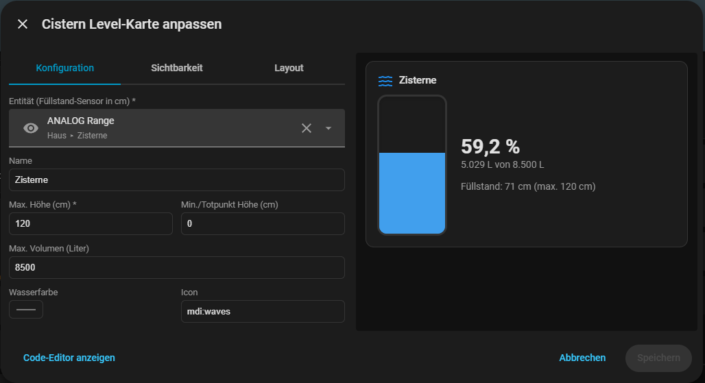

# Cistern Level Card

Eine Lovelace-Karte für Home Assistant, die den Füllstand einer Zisterne (oder
eines anderen Tanks) als Grafik mit sanft bewegter Wasseroberfläche darstellt.
Aus dem Füllstand in cm werden – anhand von maximaler Höhe und Volumen –
automatisch die verbleibenden Liter berechnet.




## Voraussetzung

Ein Sensor in Home Assistant, der den Füllstand in **cm** liefert
(z. B. über ESPHome von deinem ESP32/ADS1115- oder Radar-Sensor).

## Installation über HACS

1. HACS → Frontend → oben rechts die drei Punkte → **Benutzerdefinierte Repositories**
2. Repository-URL eintragen, Kategorie **Dashboard**
3. "Cistern Level Card" installieren
4. Home Assistant neu laden (Browser-Cache ggf. leeren)

## Konfiguration

```yaml
type: custom:cistern-level-card
entity: sensor.zisterne_fuellstand_cm
name: Zisterne
max_height_cm: 200
min_height_cm: 0
max_volume_l: 6000
decimals: 0
water_color: "#1e88e5"
# water_color_light: "#4fa8f0"   # optional, sonst automatisch aus water_color
show_liters: true
show_percentage: true
icon: mdi:waves
```

| Option | Pflicht | Standard | Beschreibung |
|---|---|---|---|
| `entity` | ja | – | Sensor mit Füllstand in cm |
| `name` | nein | Entitätsname | Angezeigter Titel |
| `max_height_cm` | ja | 200 | Füllstand bei 100 % |
| `min_height_cm` | nein | 0 | Toter Raum / Sensor-Offset am Boden |
| `max_volume_l` | nein | – | Fassungsvermögen; ohne diese Angabe wird nur % angezeigt |
| `decimals` | nein | 0 | Nachkommastellen bei der Liter-Anzeige |
| `water_color` / `water_color_light` | nein | Blau / automatisch heller | Wasserfarbe; die Wellenfarbe wird aus `water_color` abgeleitet, wenn nicht gesetzt |
| `show_liters` / `show_percentage` | nein | true | Anzeige ein-/ausblenden |
| `icon` | nein | mdi:waves | Kopfzeilen-Icon |

## Wichtiger Hinweis zur Liter-Berechnung

Die aktuelle Version rechnet **linear**: `Liter = (Füllstand / max_height_cm) × max_volume_l`.
Das ist exakt korrekt bei stehenden zylindrischen oder quaderförmigen Tanks.

Bei einem **liegenden Rundtank** (häufige Bauform bei erdverlegten Zisternen)
ist der Zusammenhang zwischen Höhe und Volumen **nicht linear** (Kreissegment-Formel).
Für diesen Fall kann eine `volume_curve`-Option ergänzt werden, die den Tank in
Höhen-Stützstellen mit zugehörigem Volumen beschreibt – sag Bescheid, falls das
für dich relevant ist, dann bauen wir das nach.

## Änderungen / Weiterentwicklung

Ideen für die nächste Ausbaustufe:
- Nicht-lineare Volumenkurve für liegende Rundtanks
- Warn-Schwellenwert (z. B. rote Einfärbung unter 15 %)
- Trend-/Verbrauchsanzeige (Liter/Tag) über `sensor.zisterne_fuellstand` Historie
- Mini-Graph der letzten 7 Tage unterhalb des Tanks

## Versionen / Releases

HACS zeigt nur dann eine Versionsnummer statt eines Commit-Hashes, wenn es ein GitHub-Release gibt.
Neues Release erstellen:

1. `CARD_VERSION` in `cistern-level-card.js` und `CHANGELOG.md` anpassen, per PR mergen
2. Release erstellen, entweder
   - in GitHub unter **Actions → Release → Run workflow** den Tag (z. B. `v1.2.0`) eingeben, oder
   - per Git: `git tag v1.2.0 && git push origin v1.2.0`
3. Der Workflow `.github/workflows/release.yml` legt das Release inklusive `cistern-level-card.js` an
